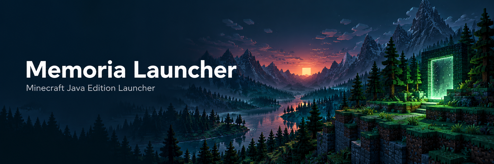

# Memoria Launcher

**一个使用 Rust 与 iced 构建的 Minecraft Java Edition 桌面启动器。**

管理本地游戏版本、通过 Microsoft 账户登录并启动游戏，也为外部 AI 客户端提供按类别和实例授权的 MCP 工具。项目处于开发阶段，优先接入真实数据，并明确展示尚未完成的功能。

An independent Minecraft Java Edition launcher built with Rust and iced. It provides local instance discovery, Microsoft account authentication, authenticated game launching, and optional permission-scoped MCP tools. This project is under active development and is not affiliated with or endorsed by Microsoft or Mojang Studios.

[Microsoft 登录说明](docs/microsoft-login.md) · [API 申请与审核说明 / API review](docs/api-application.md) · [数据来源与配置](docs/real-data-integration.md) · [AI / MCP](docs/mcp.md) · [后续开发进度](docs/development-progress.md) · [工作区界面](docs/workspace-ui.md)

## 已实现

| 功能 | 当前行为 |
| --- | --- |
| 本地游戏库 | 扫描 `versions/` 与兼容的 `version/` 目录，读取版本、加载器、Java 要求与客户端 JAR 状态 |
| 游戏设置 | 多个实例集文件夹；检测 Java 并从下拉列表选择或手动导入；自动分配内存或按总内存比例拖动滑块，配置保存后用于实际启动 |
| 账户管理 | 系统浏览器 Microsoft OAuth 授权码 + PKCE 登录，支持添加、切换与退出账户 |
| 登录应用设置 | 在 **设置 → 账户登录** 填写客户端 ID 和回调地址，保存后立即生效，重启自动读取 |
| 游戏启动 | 使用所选账户刷新并验证会话，检查 Java 与本地依赖，启动 Java 进程并显示日志路径与退出状态 |
| 异常退出检测 | 非正常退出时提示启用 AI 分析；用户确认发送后才上传本次启动日志末尾，可移除附件 |
| 官方版本目录 | 从 Mojang 官方版本清单读取真实版本、发布时间与元数据地址 |
| 下载安装 | 下载原版客户端、依赖库、原生库与资源，校验 SHA-1，安装后自动扫描到当前实例集 |
| 下载设置 | 官方、BMCLAPI 或自定义兼容镜像；支持 1–64 个并行下载，保存后新任务生效，重启保留 |
| 本地统计 | 统计实例隔离目录内的 Mod JAR 数量；尚未记录的游玩时长显示“未记录” |
| 第三方资源目录 | Modrinth 模组、整合包、资源包与光影搜索，支持版本/加载器筛选、分页，以及版本文件和依赖预览 |
| 工作区 | 主页、实例项目与独立对话列表；每个项目右端可直接启动对应实例 |
| AI 对话 | 条形输入框、多对话切换、连续追问；加号添加实例日志上下文、图片、文本/配置及 PDF |
| MCP 服务 | AI 设置中配置内置 stdio 服务，选择读取/写入权限和授权实例；服务端执行并动态重读权限 |

**尚未完成：** 第三方加载器与资源安装、依赖求解、AI 自动组包与汉化、安装变更审批与事务部署、非 Windows 系统的安全凭据存储。旧版 virtual/map_to_resources 资源布局会明确报错。界面不会为这些功能生成虚构的成功结果或下载进度。

## 本地运行

安装 Rust stable 工具链。Windows 构建使用 MSVC 工具链，需要 Visual Studio Build Tools 的 C++ 桌面开发组件；启动 Minecraft 另需对应版本的 Java 与完整游戏文件。

```powershell
git clone https://github.com/zhixuan45/MemoriaLauncher.git
cd MemoriaLauncher
cargo run --locked -p desktop
```

首次使用：

1. 在 **设置 → 游戏设置** 新建或导入实例集文件夹（如 `.minecraft`），支持管理多个文件夹。选择当前实例集，设置内存与 Java 路径，点击 **保存并应用**。
   在 **设置 → 下载安装** 选择下载源及并行数量并保存；在 **游戏下载** 页面点击 **安装此版本**，将原版游戏安装到当前实例集。
2. 如果构建尚未内置登录应用 ID，在 **设置 → 账户登录** 填写自己注册的 Microsoft 应用客户端 ID；默认回调为 `http://localhost:53682/oauth/callback`，应与应用注册一致。点击 **保存登录配置**，无需反复设置环境变量。
3. 点击左下角账户区域，选择 **添加 Microsoft 账户**，在系统浏览器完成授权。
4. 选择完整的本地实例，点击 **开始游戏**。Java、凭据或依赖问题会显示实际错误。

普通玩家使用已配置应用 ID 的发行版时无需注册 Microsoft 应用。开发者可使用下方本地 JSON 配置或 `MEMORIA_MICROSOFT_CLIENT_ID` 在编译时内置自己的应用 ID；本机设置优先于运行时环境变量和发行版默认值。完整流程见 [Microsoft 登录说明](docs/microsoft-login.md)。

### 使用 JSON 配置打包

在项目根目录的 `build-config.local.json` 中填写 `microsoft_client_id` 即可。该文件已被 Git 忽略；首次克隆项目时，从已提交的示例复制：

```powershell
Copy-Item build-config.example.json build-config.local.json
```

将 `microsoft_client_id` 的空字符串替换为自己的 Microsoft **应用程序（客户端）ID**，然后执行：

```powershell
cargo build --locked -p desktop --release
```

构建会自动读取 JSON 并把 ID 内置到 `target/release/desktop.exe`，分发时无需携带配置文件。修改配置后再次构建会自动更新；文件缺失或 ID 留空时不内置 ID。编译时非空的 `MEMORIA_MICROSOFT_CLIENT_ID` 环境变量优先于 JSON，方便 CI 打包。

这里的应用 ID 是公共标识符，并非客户端密码；JSON 不用于存放 Microsoft client secret、AI API Key 或账户令牌。

## Microsoft / Minecraft API 用途

本项目希望让拥有 Minecraft Java Edition 权益的用户在独立桌面启动器中登录自己的账户，读取自身的 Java 玩家档案，并启动本地游戏。认证链路为：

`系统浏览器 → Microsoft OAuth + PKCE → Xbox Live → XSTS → Minecraft Services → 权益与玩家档案校验 → 本地启动`

OAuth 请求的 scope 为 `XboxLive.signin offline_access`。Microsoft 账户密码在微软登录页面输入，启动器不收集密码；应用不使用嵌入式客户端密码。Windows 刷新令牌保存在系统凭据管理器，账号索引与登录应用配置文件不包含令牌。AI 对话与 MCP 工具不接收 Microsoft/Minecraft 凭据。

**项目没有声称已获 Microsoft、Xbox 或 Minecraft API 批准。** 应用注册、相应服务的访问资格及真实账户端到端测试仍需由维护者完成。供审核人员查看的用途、权限、数据处理和代码入口见 [API 申请与审核说明](docs/api-application.md)。

## AI 与 MCP

在“设置 → AI 设置”填写兼容接口地址、模型名称与 API Key，点击“保存并应用”后生效，重启自动读取。地址、模型与密钥引用保存在 `%LOCALAPPDATA%/MemoriaLauncher/ai.json`（支持 `MEMORIA_DATA_DIR` 覆盖目录），API Key 保存在 Windows 凭据管理器，不写入 JSON。清空密钥后保存可移除已存密钥；本机服务允许不使用密钥。“测试连接”使用当前填写的配置发送简短测试，不会保存配置。消息与最近最多 12 轮对话上下文会发送给用户选定的服务；可直接在消息中说明目标版本和输出语言。会话仅保存在本次运行内，清空会话会同时移除日志和文件附件。当前 AI 对话不调用本地工具，也不会代替用户安装或修改实例。

实例以非零退出码或信号终止时，会弹出异常退出提示。点击 **启用 AI 分析** 会在 AI 页附加本次启动日志末尾（最多读取 64 KiB），点击 **发送** 才会交给所选服务；也可暂不分析或移除日志。常见凭据行会被遮蔽，但日志仍可能包含玩家名、本地路径等信息。原始日志附件只随本次确认的消息发送，不会作为后续对话上下文重复上传。顶部 **异常退出记录** 可重新打开最近一次提示。正常退出和启动前的校验失败不会触发该提示。

在 **设置 → AI 设置 → MCP 服务器** 选择启用、允许的权限和实例并保存，再复制客户端连接配置。配置保存在 `mcp.json`，现有服务在下一次请求读取新权限。未保存该文件前，独立 CLI 保留原有只读行为。

输入框的 **＋** 可启用当前实例日志上下文，或选择图片、UTF-8 文本/配置和 PDF；点击发送才上传。图片和 PDF 需要模型支持。最多 4 个文件、单个 4 MiB、合计 8 MiB，文本合计最多 48 KiB。详见 [工作区界面](docs/workspace-ui.md)。

单独构建 MCP 服务：

```powershell
cargo build --locked -p mc-mcp
.\target\debug\mc-mcp.exe --game-root=C:\Games\.minecraft
```

默认提供 `minecraft_list_versions`、`minecraft_list_instances`、`minecraft_search_mods`、`minecraft_get_mod_info`、`minecraft_list_instance_logs`、`minecraft_read_instance_log` 六个只读工具。保存授权后可使用来源 ID / JAR 安装、配置写入、FTB 语义化任务和图片写入；先预览再按哈希应用。任务图标、条件和奖励均校验实际物品注册表。客户端配置见 [MCP 文档](docs/mcp.md)，写入格式与限制见 [实例写入](docs/mcp-writes.md)。

## 配置与凭据

| 内容 | Windows 默认位置 |
| --- | --- |
| Microsoft 应用客户端 ID、回调地址 | `%LOCALAPPDATA%\MemoriaLauncher\microsoft-login.json` |
| 账户名称、UUID、当前账户 | `%LOCALAPPDATA%\MemoriaLauncher\accounts.json` |
| 实例集文件夹、内存与 Java 路径 | `%LOCALAPPDATA%\MemoriaLauncher\environment.json` |
| 下载源、自定义镜像与并行数量 | `%LOCALAPPDATA%\MemoriaLauncher\downloads.json` |
| Microsoft 刷新令牌 | Windows Credential Manager：`MemoriaLauncher/Microsoft/<account-id>` |

`MEMORIA_DATA_DIR` 可覆盖启动器配置目录。退出某个账户会删除对应的本地刷新令牌和账户记录；微软服务器端的权限撤销由用户在 Microsoft 账户中管理。

## 开发与验证

```powershell
cargo check --workspace --locked
cargo test --locked -p desktop -p mc-core -p mc-mcp -- --test-threads=1
cargo build --locked -p desktop
```

Mojang 官方清单的联网检查单独执行：

```powershell
cargo test --locked -p mc-core official_catalog_is_reachable -- --ignored
```

离线测试不代表真实 Microsoft 登录、第三方 API 访问资格或游戏进程端到端验证已完成。

| 路径 | 职责 |
| --- | --- |
| `apps/desktop` | iced 界面、账户与设置、本地启动、可选 AI 对话 |
| `crates/mc-core` | 领域模型、认证、目录查询、游戏扫描与启动服务 |
| `crates/mc-mcp` | 按权限授权的 MCP stdio 服务 |
| `crates/vendor/mc-launcher-core` | 随仓库保留的第三方启动库及本地修改 |
| `docs` | 认证、API 审核、MCP、架构与配置说明 |

## 反馈与许可

问题与反馈请提交到 [GitHub Issues](https://github.com/zhixuan45/MemoriaLauncher/issues)。提交日志时请先移除访问令牌、刷新令牌与 API Key。

主项目目前尚未指定统一的开源许可证。第三方组件的许可与版权声明见 [THIRD_PARTY_NOTICES.md](THIRD_PARTY_NOTICES.md) 及对应组件目录。头图为 AI 生成的项目宣传插画，不是应用截图或游戏内截图。

Minecraft 是 Mojang Studios 的商标。Memoria Launcher 是独立项目，与 Microsoft 或 Mojang Studios 没有隶属或官方背书关系。
